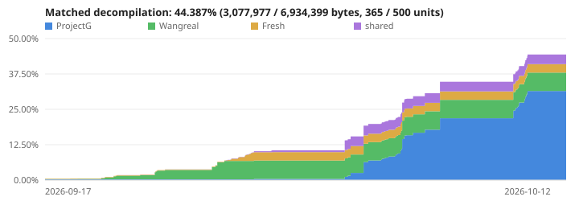

# Rebang

This is a (WIP) matching decompilation of ProjectG, client version 645, build type ReleaseQA. This project is intended primarily for educational purposes.

## Progress

[](./docs/progress.md)

## Getting Started

### Prerequisites

This project contains a Nix flake and direnv setup pointing to it. If you have both Nix and direnv configured and installed, all of the dependencies will automatically be injected into the environment whenever a shell enters the directory, after running `direnv allow` once inside of it.

Nix is *not* required to build. However, for practical reasons, Linux _is_ required to build, at least for now. A Linux VM or container setup like WSL2 should work perfectly fine. Inside your Linux environment, the following is required:

- Python 3.10 or newer
- Wine
- GNU Make
- GNU Patch
- Ruff + Ty, for `make check`
- Clang Format, for `make format`
- Git

For linting the GitHub Actions workflows,

- Actionlint
- Zizmor
- Shellcheck

### Building

Whatever your local setup may be, `make` is used for most things.

```
# Build the project.
make -j"$(nproc)"

# Check the C++ formatting.
make format-check

# Fix the C++ formatting.
make format

# Check the Python build script with Ruff + Ty.
make check

# Run the verify step explicitly.
make verify

# Clean up build artifacts.
make clean
```

### How do I decompile?

There is no specific approach to decompilation. Delinked objects are lossy and do not represent the original compiler output, which also is quite lossy from the original source code. The goal is to find *a* source code that matches, ideally a *clean* source code that matches, but you can only ask for so much. A lot of the job is trial and error, ideally automated where possible.

Some documentation is available in the [docs](./docs) folder; of particular interest is probably the [troubleshooting document](./docs/troubleshooting.md).
